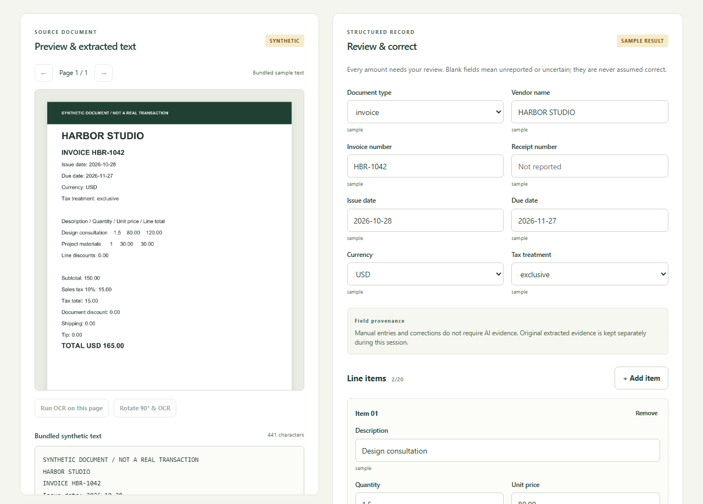

# AI Invoice & Receipt Processor

**Ledger Lens** turns invoice/receipt documents into text locally, lets you review structured values, and exports corrected JSON or CSV. Optional cloud AI extraction is implemented behind consent and protection gates. **The branded production launch is in verification. Real Turnstile validation has passed; live model acceptance results will be recorded separately. Local development and previews remain disabled/mocked.**

[Open Ledger Lens](https://invoice.mubashirhussain.dev) · [Original Vercel URL](https://ai-invoice-receipt-processor.vercel.app) · [GitHub repository](https://github.com/mubidotjs/ai-invoice-receipt-processor) · [Worker health](https://ai-invoice-receipt-processor.mubikhan69.workers.dev/health)

## What it does

- Processes one PNG, JPEG or unencrypted PDF locally; up to 10 MiB and three PDF pages of one document.
- Extracts native PDF text or runs real Tesseract OCR on scanned pages; previews every page and supports explicit OCR override/rotation.
- Provides six synthetic examples across USD, EUR, GBP and PKR. English only, with decimal-point numeric formatting.
- Keeps **real OCR**, **native PDF text**, **deterministic sample results**, **manual values** and **cloud AI drafts** distinct.
- Checks strict schemas and performs decimal-safe arithmetic diagnostics, including tax treatment, discounts and totals.
- Tracks AI evidence separately from manual entries/corrections. Manual-only review and exports work without AI.
- Requires current-revision review and explicit acknowledgment of unresolved warnings. Invalid formats block export.
- Downloads structured JSON and spreadsheet-safe CSV locally.

Financial consistency checks do not prove a document or financial value is correct. The preview and human review remain essential.



## Run locally

Use Node **24.x** and npm **11+**. From the workspace root:

```sh
npm ci --cache .npm-cache
npm run dev
```

Open `http://127.0.0.1:5401`. The disabled local Worker runs at `http://127.0.0.1:8788`; no Cloudflare account/login is needed. `npm run dev` bundles assets first. **Do not add an AI binding or remote development flag for A–D.**

For the frontend alone, run `npm run assets` followed by `npm run dev -w web`.

The bundled assets include OCR code, all compatible core/WASM variants, English trained data, PDF worker/fonts/CMaps/ICC/WASM resources and license notices. No runtime CDN fallback, service worker or document cache is used.

## Offline demonstration

After installing dependencies and preparing assets:

```sh
npm run build
npm run preview -w web
```

Keep localhost available and block external network access. Process a sample document, inspect the preview/text, manually enter or correct values, review warnings and download JSON/CSV. No AI or Turnstile request is needed. This guarantee covers a local server after setup; it does not promise hosted offline reloads.

**Process sample document** runs actual extraction. **Load sample result** supplies bundled synthetic text/data without OCR or inference. Both keep the synthetic label in exports.

## Verification

```sh
npm run test:browser:install
npm run check
```

`check` runs types, lint, Vitest, frontend build, Worker `deploy --dry-run`, and Playwright. The dry run bundles locally and never deploys. On Linux, install browser system dependencies with `node scripts/browser.mjs install --with-deps chromium` on an appropriate host.

Tests use only synthetic documents. Browser tests exercise actual OCR/PDF processing with external requests blocked, corrected download bytes, accessibility at three widths, file rejection and cancellation. The separate test-only frontend on port 5402 mocks both the widget script and AI endpoint; it is not a real Turnstile or model verification.

See [evaluation](docs/EVALUATION.md), [architecture](docs/ARCHITECTURE.md), [security and privacy](docs/SECURITY.md), and [Gate E deployment procedure](docs/DEPLOYMENT.md).

## Structure

```text
web/                 React UI, browser OCR/PDF adapters, review and downloads
worker/              Protected text-only extraction handler; disabled defaults
shared/              Zod contracts, source checks, arithmetic and exports
fixtures/            Six synthetic documents, expected values and demo results
tests/               Browser workflows and rejection fixtures
scripts/             Asset/fixture preparation and local tooling
docs/                Architecture, security, evaluation and launch procedure
```

No database, accounts, document storage, analytics, RAG, agents, paid APIs or Vercel backend. Use synthetic documents for public demonstration and production tests. No general model-accuracy claim is made.

The synthetic fixture source is `scripts/fixtures.mjs`; regeneration requires Poppler (`PDFTOPPM` may override its executable path). Expected values are authored explicitly, never generated by OCR or a model. Tests and normal builds use committed fixtures and do not require Poppler or Python.

Vercel Hobby is intended for personal/noncommercial projects. Cloud AI's free allocation is shared across the Cloudflare account and is not guaranteed to remain available. No paid fallback is configured.
