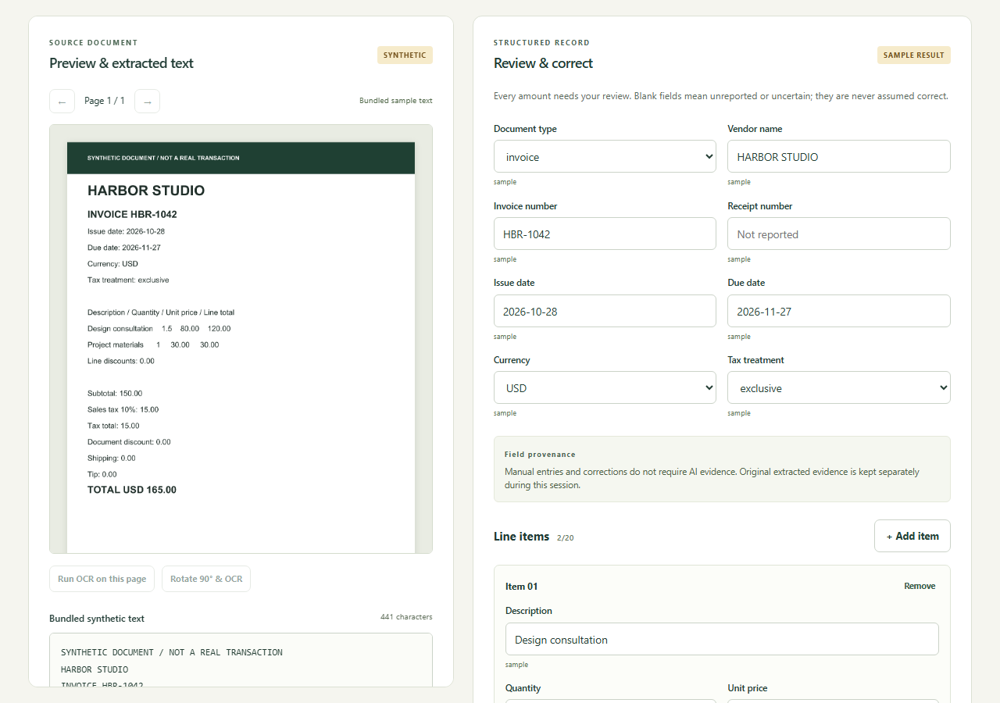

# Deployment and production launch outcome

Verified **2026-11-12**. The owner authorized the branded domain and Gate E2. **The branded local demonstration is available; Gate E2 live AI acceptance is blocked and inference has been disabled again.** Real protection passed. Neither bounded AI submission yielded an accepted draft, so no real model field-accuracy or successful AI-correction claim is made.

## Current verified resources

| Resource                         | Verified identity / result                                                                                                                                                                                                  |
| -------------------------------- | --------------------------------------------------------------------------------------------------------------------------------------------------------------------------------------------------------------------------- |
| Canonical frontend               | [invoice.mubashirhussain.dev](https://invoice.mubashirhussain.dev), HTTPS 200                                                                                                                                               |
| Preserved frontend               | [ai-invoice-receipt-processor.vercel.app](https://ai-invoice-receipt-processor.vercel.app)                                                                                                                                  |
| Repository                       | [mubidotjs/ai-invoice-receipt-processor](https://github.com/mubidotjs/ai-invoice-receipt-processor), protected main; required check, no force push                                                                          |
| Verified application source      | 023656b5e35a77109f27950be2cd8a2d8e83f053; [CI 43204278338](https://github.com/mubidotjs/ai-invoice-receipt-processor/actions/runs/43204278338) passed: 119 unit/integration tests, 18 browser tests, types, lint and builds |
| Vercel project                   | ai-invoice-receipt-processor, prj_hRfp70QSVa7ab6XvU1R1PcpxFIRB, personal mubidotjs-projects scope, Hobby                                                                                                                    |
| Verified disabled frontend build | dpl_3UqxPteZyS6qg5aH1wEqjgXrEP25, READY; both public hosts associated; application commit above                                                                                                                             |
| Actual hosted toolchain          | Build logs: Node v24.22.3, npm 11.19.1                                                                                                                                                                                      |
| Build                            | Root install: node --version && npm --version && npm ci --cache .npm-cache; build: npm run assets && npm run build -w web; output web/dist; static assets only                                                              |
| Worker                           | [health](https://ai-invoice-receipt-processor.mubikhan69.workers.dev/health), existing service ai-invoice-receipt-processor                                                                                                 |
| Current safe Worker version      | c8b89a14-9973-4820-92d4-273459c12343; health 200, liveEnabled false                                                                                                                                                         |
| Worker flags                     | LIVE_AI_ENABLED=false; ABUSE_CONTROLS_VERIFIED=true (real protection verified)                                                                                                                                              |
| Frontend flag                    | VITE_LIVE_AI_ENABLED=false in Production and Preview; local default false                                                                                                                                                   |
| Production public configuration  | VITE_WORKER_URL is the existing Ledger Lens Worker; VITE_TURNSTILE_SITE_KEY is 0x4AAAAAAF9u_exNZlyI1Aql; no browser secret                                                                                                  |
| Bindings                         | Native AI; VISITOR_LIMITER namespace 12001, 2/60s; AGGREGATE_LIMITER namespace 12002, 5/60s per location; unchanged independent namespaces                                                                                  |
| Turnstile                        | Existing Ledger Lens Managed widget, no pre-clearance; encrypted unchanged TURNSTILE_SECRET only in Worker                                                                                                                  |
| Plans                            | Vercel Hobby and Workers Free ($0 current plan) confirmed; no billing, paid fallback, AI Gateway or infrastructure additions                                                                                                |

These identifiers name the actual build/version used for acceptance. A later documentation/configuration-only main commit may trigger a successor Vercel build with the same disabled application; use its GitHub/Vercel history for the final publication SHA. CI never deploys the Worker.

## DNS and HTTPS

Added exactly one Dynadot record: **invoice CNAME db955ab68dd01317.vercel-dns-017.com**, TTL **300 seconds**, using Vercel's project-supplied target. No conflicting invoice record existed and no ownership TXT was required. Reopened settings confirmed persistence and preservation of all original records, nameservers, mail settings, release-notes and portfolio records.

Authoritative nameservers remain ns1.dyna-ns.net and ns2.dyna-ns.net. Both authoritative servers and public resolvers 1.1.1.1/8.8.8.8 resolved the exact target. Vercel domain association and configuration passed. TLS chain validation succeeded: SAN invoice.mubashirhussain.dev, Let's Encrypt YR2, valid **2026-11-12 05:07:56 UTC through 2027-02-10 05:07:55 UTC**. The original vercel.app hostname remains available. No root, unrelated subdomain, nameserver, registration or billing change occurred.

## Actual production protection

Production allowed origins are exactly https://invoice.mubashirhussain.dev and https://ai-invoice-receipt-processor.vercel.app. The existing Turnstile widget's hostname list contains exactly those two bare hostnames. Expected action is invoice-extract. Preview origins are not allowlisted. The existing secret was neither read, committed nor rotated.

A real legitimate challenge was verified server-side on the branded hostname: HTTP 200, expected hostname/action, explicitly no inference during the protection probe. A delayed replay, deliberately invalid token and dummy test token were rejected with 403. This is stronger evidence than a visible widget. Distinct expired-token behavior and real upstream outage injection were not separately exercised; those fail-closed branches remain mocked regression coverage.

A release blocker was fixed: Workers rejects fetch redirect:error with TypeError before sending Siteverify. The adapter now uses redirect:manual and rejects all 3xx responses. Regression tests cover 301/302/303/307/308 and structured rejection responses. Temporary probe files, header and diagnostics were removed before activation; their public URLs returned 404. No diagnostic recorded tokens, secrets, prompts or provider payloads.

Native rate-limit bindings and their actual limit/period were read back. Cloudflare-supplied visitor identity is used; user-provided identity is not accepted. Sequential disabled-inference probes returned three 503 LIVE_AI_DISABLED responses and then 429 RATE_LIMITED with Retry-After 60. Native limits are approximate and location-scoped. **Isolated aggregate-threshold denial and worldwide budget enforcement were not proven.** CORS is not authentication.

CSP permits same-origin OCR/PDF assets, only the exact Ledger Lens Worker origin and required Turnstile destinations. It prohibits arbitrary JavaScript eval, objects, framing and arbitrary network destinations; the narrow WASM allowance remains. nosniff, no-referrer and restrictive permissions headers passed. Logging/traces/issues and content caching remain disabled. Existing Vercel deployment protection was preserved.

## Real model acceptance and rollback

Rechecked the sole model **@cf/google/gemma-4-26b-a4b-it** against [Cloudflare's Free eligibility notice](https://developers.cloudflare.com/changelog/post/2026-07-28-models-require-workers-paid/), [model contract](https://developers.cloudflare.com/workers-ai/models/gemma-4-26b-a4b-it/) and linked [license](https://ai.google.dev/gemma/apache_2). Published JSON-schema support and installed adapter types were checked; this did not establish successful application output acceptance.

Only bundled synthetic documents and displayed text were submitted, sequentially with explicit consent and fresh protection. No raw document upload, automatic retry, fixture fallback, alternate model or paid call was introduced.

| Budget slot               | Actual observation                                                                                                         | Acceptance                                                                                                    |
| ------------------------- | -------------------------------------------------------------------------------------------------------------------------- | ------------------------------------------------------------------------------------------------------------- |
| 1 — Harbor Studio invoice | Actual native PDF extraction and consented UI submission; generic cloud-unavailable error; backend stage not substantiated | No draft; vendor/identifier/date/currency/total/evidence comparison not possible                              |
| 2 — Saffron Cafe receipt  | Actual Tesseract OCR and consented UI submission; native AI binding reached; AI_INVALID_OUTPUT                             | No draft; output failed envelope/schema/evidence acceptance; exact sub-cause intentionally not logged/exposed |
| 3 — optional retry        | Unused                                                                                                                     | Stopped: one remaining slot cannot complete both required positive cases                                      |

The maximum was three inference attempts. Two guarded submissions conservatively consumed two slots; at least one native-binding attempt is confirmed, and the first stage is unknown. **Zero accepted drafts.** Do not describe these as two successful generations or invent model values/accuracy. Authored totals USD 165.00 and PKR 680.00 were used only as ground truth, not inserted as model output. Financial arithmetic and evidence restrictions were not relaxed.

After failure, the Worker was deployed with LIVE_AI_ENABLED=false and the frontend Production flag set false followed by a real rebuild. ABUSE_CONTROLS_VERIFIED remains true because protection actually passed; default/local remains false. Health and dashboard readback confirm disabled AI. Known safe application errors now show their safe error code, while unknown/provider messages remain hidden; this was the only live-feedback source fix and has mocked regressions.

Workers AI's free allocation is [10,000 neurons/day account-wide](https://developers.cloudflare.com/workers-ai/platform/pricing/), shared with other applications, resetting 05:00 Asia/Karachi. Before testing, the dashboard showed 0/10k today and 31.98 on the last-24h Gemma chart; final readback showed **24.81/10k today** and **56.79 last-24h Gemma**. These asynchronous, account-wide views cannot substantiate an exact project/call cost or usage delta. No billing or paid fallback was enabled.

## Production local/manual acceptance

The [launch record](evidence/gate-e2.json) separates real protection/model attempts from the [disabled public local-workflow regression](evidence/gate-e2-local-production.json). The latter intentionally reports realInference=false and realTurnstileVerification=false for that helper run only.

- All six synthetic documents passed actual hosted PDF text, image OCR, scanned PDF and mixed-page processing; previews/page navigation worked. The final regression ran after rollback with fresh contexts and external/non-GET requests blocked.
- All **228 runtime assets / 52,994,366 bytes** loaded from the application origin and matched SHA-256/size; no runtime CDN fallback or service worker.
- Twelve JSON/CSV downloads were read by the public regression; manual provenance, synthetic labels, corrected values, invalid-format rejection, review reset and warning acknowledgment passed. No unexpected external request or page error occurred.
- Manual in-app observations covered Harbor/Saffron processing and outbound text/unchecked consent, Northstar/Alder page controls, local encrypted-PDF rejection, keyboard skip navigation and actual downloads.
- Juniper's deterministic sample was clearly labeled. Correcting 37.40 to 36.40 updated arithmetic to pass and provenance to manual-correction. Clearing subtotal produced permissible warnings requiring acknowledgment. Invalid formats blocked exports and edits reset review.
- Actual manually downloaded JSON/CSV bytes retained corrections/provenance and synthetic status. CSV BOM, comma quoting and apostrophe neutralization of =SUM(1,2) passed. Whitespace-invalid form strings stayed blocked. Raw documents, full OCR text, tokens and secrets were absent.
- After the Harbor cloud failure, actual manual-only entry and both downloads succeeded, with manual-entry provenance and no fabricated AI evidence. Successful real-AI correction was **not** tested because no accepted AI draft existed.
- Actual Playwright viewport widths **390/768/1280** were asserted; no horizontal overflow, working keyboard skip navigation and zero serious/critical axe findings. Screenshots were inspected. The in-app viewport override did not resize its DOM, so this is a separate automated production responsive check, not a manual three-device audit. Dark mode is not implemented.



Reproduce only the disabled synthetic local-workflow check:

```sh
node scripts/verify-production.mjs https://invoice.mubashirhussain.dev https://ai-invoice-receipt-processor.mubikhan69.workers.dev
```

On Windows, use the workspace .cache/browsers path for PLAYWRIGHT_BROWSERS_PATH. The helper writes ignored reports/screenshots, never enables AI and never calls a model. Local npm run check uses mocks for cloud/protection and real externally blocked OCR/PDF processing.

## Rollback and remaining launch requirements

Current safe state is the rollback target: Worker **c8b89a14-9973-4820-92d4-273459c12343**, disabled frontend build **dpl_3UqxPteZyS6qg5aH1wEqjgXrEP25**, branded DNS retained. Do not restore the original E1 Worker if doing so would remove the branded allowlist.

To stop new inference, set only this Worker's LIVE_AI_ENABLED=false and deploy the reviewed production configuration from worker/ with node scripts/wrangler.mjs deploy --env production. Set this project's Production VITE_LIVE_AI_ENABLED=false and rebuild/redeploy the existing Vercel project; environment edits alone do not update static assets. Leave previews/local disabled. If protection ceases to be verified, also restore ABUSE_CONTROLS_VERIFIED=false. Never expose the secret or alter unrelated projects. Waiting deadlines cannot cancel computation already admitted by the provider.

After rollback, verify health liveEnabled=false, dashboard flags/bindings, both public hosts, local processing and downloads. Keep the verified custom DNS record and all unrelated records unchanged. Use only this service's deployment history and this Vercel project's tested builds.

Gate E1 and branded local-demo acceptance remain complete. **Gate E2 is incomplete.** Further live debugging/activation requires a separately authorized bounded attempt budget, renewed Free/quota/protection checks, both successful ground-truth/evidence comparisons and real-AI correction/download acceptance. Do not consume the unused slot merely to repeat an unsubstantiated test. Quota/provider outages remain mocked; no general model-accuracy, authenticity or distributed-abuse guarantee is made.

## Local platform notes

Node 24/npm 11 workspaces and the lockfile are retained. Local ports are 5401/5402 and 8788; update local origins together if a port is unavailable, without changing Windows exclusions or privilege settings. Wrangler state/logs and Playwright binaries are workspace-local ignored files. Stop only owned stale test servers. npm run build is a local dry-run bundle, not deployment. No cloud credential is present in CI.
